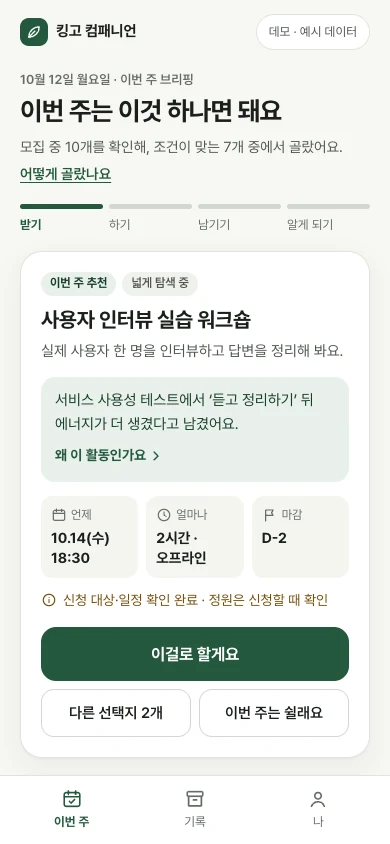
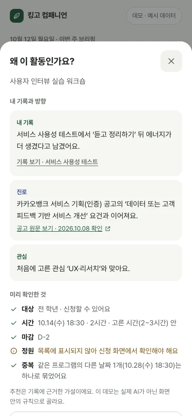
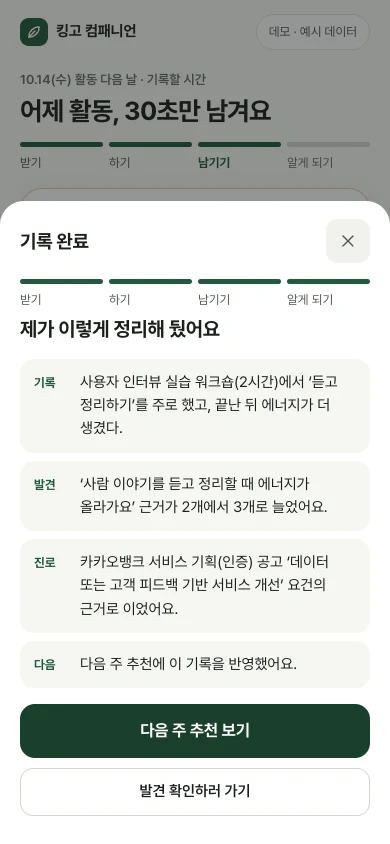
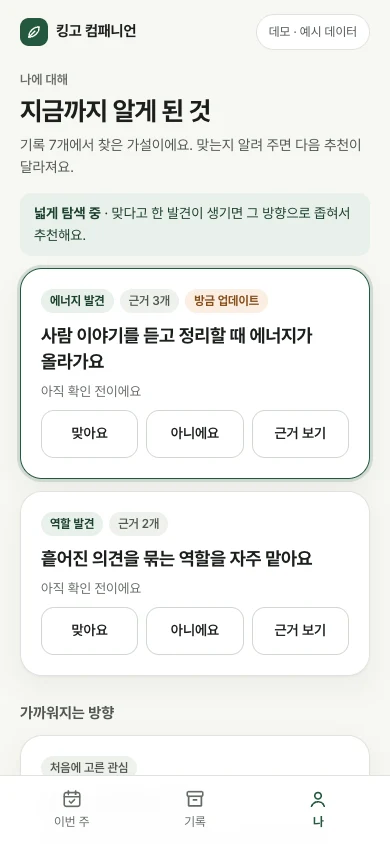

# 킹고 컴패니언 (SSA)

성균관대 학생에게 맞는 비교과를 에이전트가 대신 골라 주고, 다녀온 뒤 30초 회고를 기록·발견·다음 추천으로 잇는 서비스의 프로토타입입니다. 학교 공식 플랫폼인 챌린지스퀘어를 대체하지 않고, 그 위에서 고르기·챙기기·의미 만들기를 맡습니다.

> 현재 버전: 프로토타입 v0.7. 예시 데이터와 화면 안의 규칙으로만 동작합니다. 실제 AI, 학교 API, 챌린지스퀘어 연동, 저장소는 연결하지 않았습니다.

<p>
  
  
  
  
</p>

## 핵심 흐름: 받기 → 하기 → 남기기 → 알게 되기

- **받기**: 매주 월요일, 모집 중인 활동을 대상·마감·시간·중복까지 확인해 1개만 추천합니다. 이유는 내 기록으로 1줄, 사실은 언제·얼마나·마감 3개만 보여 줍니다.
- **하기**: 남은 일은 '챌린지스퀘어에서 신청하기' 하나입니다. 수강확정과 전날 알림은 에이전트가 챙깁니다(연동 후).
- **남기기**: 활동 다음 날, 가장 많이 한 일 → 끝난 뒤 에너지 → 한마디(선택). 탭 3번입니다.
- **알게 되기**: 기록 카드, 발견(가설) 갱신, 채용 공고 요건 연결, 다음 주 추천 반영을 한 화면에 정리합니다.

바꾸기·쉬기·별로예요는 언제든 한 번에 되고, 대부분의 행동은 되돌릴 수 있습니다. 설계 근거와 측정은 [기획서 v0.5](docs/planning/v0.5-agent-curation.md)에 있습니다.

## 실행

Node.js `^20.19.0` 또는 `>=22.12.0`이 필요합니다(`.nvmrc`: 22).

```sh
npm ci           # 처음 한 번
npm run dev      # 개발 서버
npm run check    # 타입 검사
npm run build    # 배포 빌드 (dist/)
```

`npm run build && npm run preview` 뒤 `/mobile-frame.html`을 열면 390×844 화면으로 배치를 확인할 수 있습니다.

## 폴더 구조

```
src/App.tsx        상태·예시 데이터·추천 규칙·화면
src/index.css      스타일·반응형·동작 줄이기
public/            모바일 확인용 보조 페이지
docs/              기획서, 챌린지스퀘어 조사, 이전 버전 리뷰, 스크린샷
qa/                검수 결과(v0.7)와 v0.6 기준선
```

## 버전

| 태그 | 날짜 | 내용 |
|---|---|---|
| `prototype-v0.3` | 2026-10-07 | 성장 지도·활동 탐색·ETL 흐름 비주얼 MVP |
| `prototype-v0.4` | 2026-10-07 | 6화면 인터랙티브 데모, 관계 확인·회고 초안 |
| `prototype-v0.5` | 2026-10-08 | 연결 성장 UX: 분석-그래프 강조, 회고 통합, 6축 근거 렌즈 |
| `prototype-v0.6` | 2026-10-08 | 경험과 채용 공고 요건 연결 |
| `prototype-v0.7` | 2026-10-08 | 에이전트 큐레이션 UX: 주 1개 추천, 30초 회고, 3탭 |

이전 버전 코드는 `git checkout prototype-v0.6`처럼 태그로 볼 수 있습니다.

## 작업 방식

- `main`은 항상 `npm run check`와 `npm run build`가 통과하는 상태로 둡니다.
- 새 작업은 브랜치(예: `feat/reflection-copy`)에서 하고 PR로 리뷰한 뒤 병합합니다.
- 커밋 메시지는 `영역: 무엇을 왜` 한 줄로 씁니다. 예: `추천: 같은 분야 연속 추천 감점`
- 화면 흐름이 크게 바뀌면 `prototype-vX.Y` 태그를 붙입니다.

## 데이터 원칙

- 저장소에는 예시 데이터만 둡니다. 실제 학생 기록, 학번·이름, 토큰·키는 넣지 않습니다.
- 채용 공고 요건은 2026.10.08 직접 확인한 카카오뱅크 공개 공고 3건이며 직무 참고용입니다.
- 학생을 점수·순위로 판정하지 않고, 발견은 학생이 확인·수정·삭제할 수 있는 가설로 다룹니다.

## 관련 문서

- [문서 목록](docs/README.md)
- [Notion 기획서 v0.5](https://app.notion.com/p/155ce4d2588241b8a725aa8f29f9cb82)
- [Figma Make v0.7 스냅샷](https://www.figma.com/make/DHknzG1sIEnxBdn1Pzevci) (SSA 팀 폴더, 코드 동기화는 v0.7에서 멈춤)
