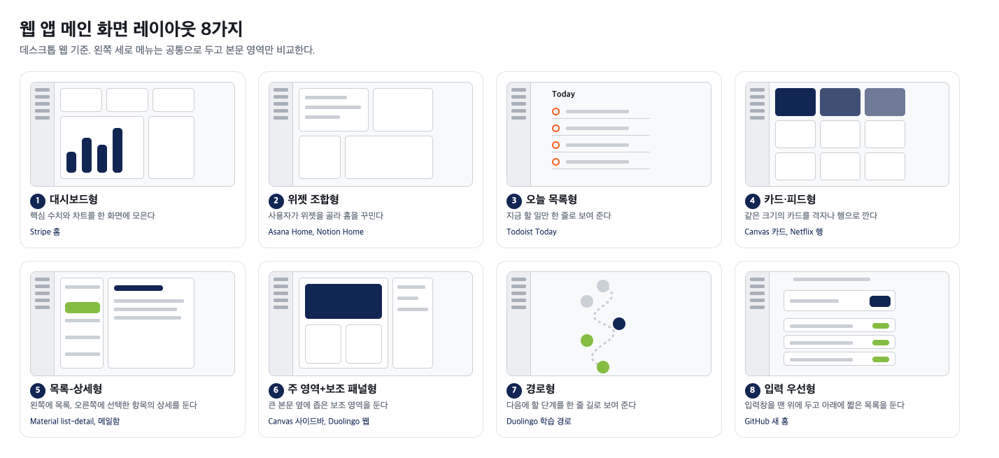
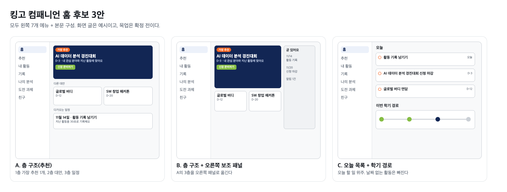

# 레이아웃 레퍼런스 조사 (Notion 사본)

> 원본: https://app.notion.com/p/409b044fa9738056a65ed95ba04e78d0 (2026-10-30). 저장소가 공개라 외부 사진은 빼고 직접 그린 개념도만 넣었다.

## 결론
- 웹 앱 메인 화면은 본문 구성에 따라 8가지로 나뉜다. 메뉴는 데스크톱에서 왼쪽 세로 메뉴가 흔하고, [NN/G](https://www.nngroup.com/articles/vertical-nav)도 왼쪽 세로 메뉴가 훑어보기 쉽다고 본다.
- 판단: 학생용 홈에는 층 구조(가장 추천 1개, 대안, 일정 순)가 우리 원칙과 가장 잘 맞는다. 대안이 보조로 따라붙기 때문이다.
- 판단: 수치를 모으는 대시보드형은 점수·순위처럼 읽힐 수 있어 피한다.
- 판단: 입력 우선형(GitHub)은 상담사형 에이전트와 닮았다. 다만 빈 입력창만 두면 처음에 막막하므로 추천 카드를 함께 둔다.
## 레이아웃 8가지 한눈에 보기

그림은 직접 그린 개념도다. 왼쪽 세로 메뉴는 공통으로 두고 본문 영역만 비교했다.
[table]
  | 유형 | 대표 사례 | 잘 맞는 경우 | 한계 |
  | 1 대시보드형 | Stripe 홈 | 상태를 한눈에 볼 때 | 지표가 많으면 무엇을 봐야 할지 흐려진다 |
  | 2 위젯 조합형 | Asana Home, Notion Home | 쓰는 방식이 사람마다 다를 때 | 처음에는 비어 있어 설정 부담이 있다 |
  | 3 오늘 목록형 | Todoist Today | 오늘 할 일에 집중할 때 | 날짜가 없는 항목은 보이지 않는다 |
  | 4 카드·피드형 | Canvas 카드, Netflix 행, Material feed | 많은 항목을 훑어보고 고를 때 | 가장 중요한 항목이 드러나지 않는다 |
  | 5 목록-상세형 | Material list-detail | 항목이 많고 하나씩 깊게 볼 때 | 홈보다 목록 화면에 가깝다 |
  | 6 주 영역+보조 패널형 | Material supporting pane, Canvas 사이드바 | 본문과 함께 일정이나 알림을 볼 때 | 보조 영역이 본문과 관련 있을 때만 쓴다 |
  | 7 경로형 | Duolingo 학습 경로 | 순서가 정해진 학습 | 자유롭게 고르는 흐름에는 맞지 않는다 |
  | 8 입력 우선형 | GitHub 새 홈 | 하고 싶은 일을 바로 시작할 때 | 입력창이 비어 있으면 막막하다 |
배치 방식 통계: [Bach 외(2023)](https://eprints.gla.ac.uk/281864/1/281864.pdf)는 대시보드 144개를 분석했다. 위에서 아래로 중요도 순서로 쌓는 층 구조가 49%로 가장 많았고, 관련 위젯을 묶는 방식이 33%, 격자에 자유롭게 놓는 방식이 22%, 행과 열로 맞추는 표 구조가 19%였다. 한 화면에 섞어 쓰는 경우도 많다.
## 유형별 대표 화면
### 1 대시보드형: Stripe
(사진: 외부 자료라 저장소에는 넣지 않음. Notion 원본 참고)
- 홈에 차트 여러 개가 놓인다. 사용자가 [Edit overview](https://support.stripe.com/questions/dashboard-home-charts-overview)에서 차트를 더하거나 뺀다.
- [NN/G](https://www.nngroup.com/articles/dashboards-preattentive)는 대시보드를 운영형과 분석형으로 나눈다. 운영형은 지금 할 일을 빠르게 알리고, 분석형은 판단을 돕는다.
- [Carbon](https://www.carbondesignsystem.com/building-blocks/data-visualization/dashboards)은 가장 중요한 것을 맨 위에 두라고 한다.
- 사진: [Stripe 지원 문서](https://support.stripe.com/questions/dashboard-home-page-charts-for-business-insights)
### 2 위젯 조합형: Asana, Notion
(사진: 외부 자료라 저장소에는 넣지 않음. Notion 원본 참고)
- Asana Home은 위젯(내 작업, 최근 프로젝트 등)을 [끌어다 놓고 크기를 바꾸며 쓰지 않는 것은 지운다](https://help.asana.com/s/article/set-up-your-ideal-workspace).
- 사진: [Asana 도움말](https://help.asana.com/s/article/how-to-customize-your-home-page)
(사진: 외부 자료라 저장소에는 넣지 않음. Notion 원본 참고)
- Notion Home은 [최근 방문한 페이지 20개와 예정된 일정](https://www.notion.so/help/home-and-my-tasks)을 보여 주고, 위젯을 켜고 끌 수 있다.
- 사진: [Thomas Frank 블로그](https://thomasjfrank.com/notion-home-everything-you-need-to-know/) (제3자 설명 글)
### 3 오늘 목록형: Todoist
(사진: 외부 자료라 저장소에는 넣지 않음. Notion 원본 참고)
- Today는 모든 프로젝트의 [오늘 할 일을 한곳에 모은다](https://www.todoist.com/help/todoist/get-started/plan-your-day-with-the-today-view-UVUXaiSs). 날짜가 없는 작업은 Today와 Upcoming에 나오지 않는다.
- 같은 데이터를 [목록, 보드, 캘린더 등 5가지 레이아웃](https://www.todoist.com/help/todoist/features/customize-views-in-todoist-AoHhBxFdZ)으로 바꿔 볼 수 있다.
- 사진: [Todoist 도움말](https://www.todoist.com/help/todoist/get-started/plan-your-day-with-the-today-view-UVUXaiSs)
### 4 카드·피드형: Canvas, Netflix, Material feed
(사진: 외부 자료라 저장소에는 넣지 않음. Notion 원본 참고)
- Canvas 대시보드는 [기본이 카드 보기](https://support.csuchico.edu/TDClient/1984/Portal/KB/Article/113411/Customize-Your-Canvas-Dashboard?SIDs=7817)이고 목록 보기와 최근 활동 보기로 바꿀 수 있다. 오른쪽 사이드바에는 [할 일과 곧 있을 일정](https://canvas.northeastern.edu/files/2022/03/Canvas-Student-Onepagers.pdf)이 붙는다.
- 사진: [PR Newswire, Instructure 2015년 보도자료](https://www.prnewswire.com/news-releases/instructure-introduces-new-contemporary-canvas-user-interface-at-instructurecon-2015-300100501.html). 현재 화면과 다를 수 있다.
(사진: 외부 자료라 저장소에는 넣지 않음. Notion 원본 참고)
- Netflix는 영상을 주제별 행으로 묶고 [가로로 넘기고 세로로 내리는 2차원 배치](https://netflixtechblog.com/learning-a-personalized-homepage-aa8ec670359a)를 쓴다. 2025년 TV 개편에서는 [메뉴를 화면 위로 옮겼다](https://www.netflix.com/tudum/articles/netflix-new-tv-layout).
- 사진: [How-To Geek](https://www.howtogeek.com/stop-scrolling-netflix-homepage-for-recommendations-use-discovery-tools-instead/) (촬영 시점 미확인)
(사진: 외부 자료라 저장소에는 넣지 않음. Notion 원본 참고)
- Material의 [feed 레이아웃](https://m3.material.io/foundations/layout/canonical-examples/feed)은 카드를 격자로 깔아 훑어보게 하고, 화면 크기에 따라 열 수가 바뀐다.
- 사진: [Android Developers](https://developer.android.com/develop/adaptive-apps/guides/canonical-layouts)
### 5 목록-상세형: Material list-detail
(사진: 외부 자료라 저장소에는 넣지 않음. Notion 원본 참고)
- 화면을 목록과 상세 두 칸으로 나눈다. [메일함과 열어 본 메일, 파일 탐색기와 열린 폴더](https://m3.material.io/foundations/layout/canonical-examples/list-detail)가 예다.
- 사진: [Android Developers](https://developer.android.com/develop/adaptive-apps/guides/canonical-layouts)
### 6 주 영역+보조 패널형: Material supporting pane
(사진: 외부 자료라 저장소에는 넣지 않음. Notion 원본 참고)
- 본문이 주 영역을 차지하고 [보조 내용은 옆 패널](https://m3.material.io/foundations/layout/canonical-examples/supporting-pane)에 둔다. 보조 내용이 본문과 관련 있을 때만 쓰고, 부모-자식 관계면 list-detail을 쓰라고 한다.
- 사진: [Android Developers](https://developer.android.com/develop/adaptive-apps/guides/canonical-layouts)
### 7 경로형: Duolingo
(사진: 외부 자료라 저장소에는 넣지 않음. Notion 원본 참고)
- 2022년 홈 개편으로 [학습 경로](https://blog.duolingo.com/new-duolingo-home-screen-design)를 도입했다. 레슨은 정해진 순서로 놓이고, 스토리는 별도 탭이 아니라 경로 안에 들어갔다.
- 사진으로 보면 웹 화면은 왼쪽 메뉴, 가운데 경로, 오른쪽 보조 카드의 3열이다. (관찰)
- 사진: [Mobbin](https://mobbin.com/explore/screens/8bf064e0-51a7-49ad-8ff3-1477762dfedc)
### 8 입력 우선형: GitHub
(사진: 외부 자료라 저장소에는 넣지 않음. Notion 원본 참고)
- GitHub 홈은 에이전트 작업, 풀 리퀘스트, 이슈의 [짧은 목록을 기본으로 보여 준다](https://github.blog/changelog/2025-10-28-home-dashboard-update-in-public-preview/). 기존 피드는 별도 페이지로 옮겼다. 2025년 10월 공개 미리보기 단계였다.
- 사진으로 보면 맨 위에 입력창이 있다. (관찰)
- 사진: [GitHub 변경 내역](https://github.blog/changelog/2025-10-28-home-dashboard-update-in-public-preview/)
## 우리 서비스에 쓸 때
아래 표는 판단이다. 조사 자료에 나온 결론이 아니다. 원칙은 학생끼리 비교하지 않기, 가장 추천하는 것 1개와 대안 함께 보여 주기, 데스크톱 웹이다.
[table]
  | 유형 | 맞는 점 | 부딪히는 점 | 판단 |
  | 1 대시보드형 | 현황을 한눈에 본다 | 지표가 점수·순위 비교로 읽힌다 | 쓰지 않음 |
  | 2 위젯 조합형 | 학생마다 보는 것이 다르다 | 처음엔 비어 있어 설정 부담이 크다 | 나중에 검토 |
  | 3 오늘 목록형 | 해야 할 일이 분명하다 | 날짜 없는 활동이 빠진다 | 일정 영역에만 |
  | 4 카드·피드형 | 대안을 훑어보기 쉽다 | 가장 중요한 것이 묻힌다 | 대안 영역에만 |
  | 5 목록-상세형 | 추천 목록과 상세를 오간다 | 홈보다 추천 화면에 맞다 | 추천 화면에 |
  | 6 주 영역+보조 패널형 | 일정과 알림을 옆에 둔다 | 본문이 좁아진다 | 검토 |
  | 7 경로형 | 학기 흐름이 보인다 | 자유 선택인 비교과와 맞지 않는다 | 일부만 |
  | 8 입력 우선형 | 상담사형 에이전트와 닮았다 | 빈 입력창은 막막하다 | 추천 카드와 함께 |
## 홈 후보 3안

- A: 층 구조. 가장 추천 1개, 대안 2개, 다가오는 일정 순이다. 지금 목업과 가장 가깝다.
- B: A의 일정을 오른쪽 보조 패널로 옮긴다. 본문이 좁아지는지 확인이 필요하다.
- C: 오늘 목록과 학기 경로. 날짜 없는 활동이 빠진다.
- 판단: A를 기본으로 두고 B는 화면 너비를 보고 정한다. 목업은 아직 확정 전이다.
## 한계와 확인할 것
- 이미지는 외부 자료다. 팀 내부 참고용으로만 쓴다. 해상도와 시점이 서로 다르고 일부는 제3자 글에서 가져왔다.
- 직접 캡처하지 못했다. 로그인이 필요하거나 데스크톱 화면을 얻기 어려워 공개된 문서와 보도 이미지를 썼다.
- Bach 외 통계는 데이터 대시보드 기준이다. 학생용 홈에 그대로 적용하기는 어렵다.
- 학생 사용성은 검증하지 않았다. 후보 3안은 사용자 테스트로 확인해야 한다.
- 8가지 분류는 공개 자료를 묶은 것이다. 표준 분류가 아니다.